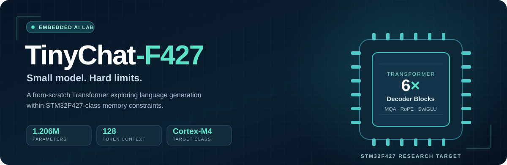
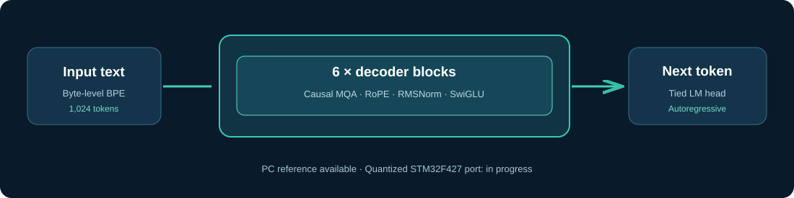

<p align="center">
  
</p>

<p align="center">
  <a href="#get-started">Get started</a> ·
  <a href="#architecture">Architecture</a> ·
  <a href="#results--limitations">Results</a> ·
  <a href="docs/ROADMAP.md">Roadmap</a> ·
  <a href="CONTRIBUTING.md">Contribute</a>
</p>

<p align="center">
  <a href="LICENSE"></a>
  
  
  
  <a href="https://github.com/Saitanveesh/Tiny-ChatF427/issues"></a>
</p>

<p align="center"><strong>What happens when you design a language model around a microcontroller's memory budget instead of a GPU?</strong></p>

**TinyChat-F427** is an open-source research project exploring compact autoregressive language generation for **STM32F427-class Arm Cortex-M4 hardware**. It provides a from-scratch Transformer, a 1,024-token tokenizer, PC reference inference, recorded experiments, and the design constraints for a future on-device implementation.

> [!IMPORTANT]
> **Project stage: PC-trained reference model; MCU Transformer deployment not yet demonstrated.** Earlier small neural models and hardware tests ran on STM32F427-class hardware. The final 1,206,864-parameter Transformer has **not** been shown running end-to-end on the board. The final FP32 checkpoint is **not included** in this public repository snapshot, so interactive chat requires a separately supplied checkpoint.

## Why this is interesting

Most language-model projects begin with available compute. TinyChat-F427 begins with a hard constraint: an MCU class with **up to 2 MB on-chip Flash, approximately 256 KB SRAM, and no NPU**.

- **Learn:** inspect a compact decoder-only Transformer without a giant framework.
- **Measure:** explore what storage, KV cache, context length, and quantization imply for embedded inference.
- **Reproduce what is available:** inspect tokenizer artifacts, model code, controlled evaluation data, and recorded training results.
- **Help build the next step:** contribute quantized kernels, memory instrumentation, tests, or clearer reproducibility tools.

This is a systems and research prototype—not a general-purpose chat assistant or a finished embedded product.

## Project snapshot

| Area | Status | What is available |
|:--|:--|:--|
| Transformer architecture | **Implemented** | Importable PyTorch model; exact parameter accounting |
| Tokenizer | **Available** | Frozen byte-level BPE, vocabulary and merges |
| PC inference | **Code available** | Interactive script; separate checkpoint required |
| Recorded training and evaluation | **Documented** | Results, selected data, logs and historical notes |
| STM32F427 hardware bring-up | **Documented** | Serial / compute tests and earlier tiny neural inference |
| Final quantized Transformer on MCU | **Open milestone** | No verified end-to-end firmware, latency or SRAM measurements |

Follow the [live project status](docs/PROJECT_STATUS.md) and [development roadmap](docs/ROADMAP.md).

## Architecture

<p align="center">
  
</p>

| Specification | Value | Specification | Value |
|---|---:|---|---:|
| Parameters | **1,206,864** | Context length | **128** tokens |
| Transformer blocks | **6** | Model width | **144** |
| Query heads | **4** | KV heads | **1** |
| FFN width | **288** | Vocabulary | **1,024** |
| Attention | Causal multi-query | Positional encoding | RoPE |
| Feed-forward | SwiGLU | Normalization | Pre-RMSNorm |
| LM head | Tied embedding | Weight initialization | From scratch |

Architecture choices deliberately trade capability for a tighter memory envelope. For example, **INT8 weight storage is ~1.21 MB before scales and code**, while a 128-token, 6-layer, single-KV-head INT8 cache would hold **55,296 bytes of raw KV values**. Both are *estimates*, not measured firmware footprints.

For formulas and exact parameter accounting, read [Architecture](docs/ARCHITECTURE.md) and [Hardware target](docs/HARDWARE_TARGET.md).

## Get started

The code can be explored on a normal computer. **You do not need an STM32 board to inspect the architecture.**

**1. Clone and install (Python 3.10+)**

```bash
git clone https://github.com/Saitanveesh/Tiny-ChatF427.git
cd Tiny-ChatF427
python -m venv .venv
```

Activate the environment with `source .venv/bin/activate` on Linux/macOS, or `.\.venv\Scripts\Activate.ps1` in Windows PowerShell. See the [platform-specific setup guide](docs/GETTING_STARTED.md) for other shells.

```bash
python -m pip install -e .
```

**2. Verify the model without a checkpoint**

```bash
python -c "from tinychat.model import TinyChatF427, count_parameters; print(count_parameters(TinyChatF427()))"
```

Expected parameter count: **`1206864`**. This constructs the untrained architecture; it does **not** load trained weights or perform meaningful chat.

**3. Optional: run the PC chat client**

Obtain the final FP32 checkpoint from the project owner or your own original training archive, put it at `checkpoints/tinychat_f427_final_trained_fp32.pt`, verify its hash using [the manifest](checkpoints/checkpoint_manifest.json), then run:

```bash
python inference/chat_tinychat.py
```

The committed tokenizer is already at `tokenizer/tokenizer.json`. **The checkpoint is not downloadable from this repository at present.** See [Getting started](docs/GETTING_STARTED.md) for Windows-specific commands, validation, and troubleshooting.

## Results & limitations

The project preserves both promising **controlled** results and the important **unrestricted** failures:

| Recorded evaluation | Result |
|---|---:|
| Stage-F controlled factual QA (non-math) | **84.1%** |
| Stage-F held-out conversation semantic accuracy | **75.0%** |
| Stage-F synthetic unknown/refusal | **100.0%** |
| Earlier Stage-D unseen arithmetic | **14.3%** |

These percentages apply only to the project's small, specific evaluation sets—not arbitrary internet questions or general intelligence.

A separate free-form test produced failures such as:

```text
User: are you gpt
Model: Gravity.
```

**This gap is part of the research result.** The PC chat script also routes simple arithmetic through deterministic Python code; that output must not be mistaken for neural arithmetic ability.

Read [Evaluation details](docs/EVALUATION.md) and the [recorded results](results/).

## Training & reproducibility

Training began from random initialization using WikiText-103, OASST1, Dolly 15k and SQuAD. The recorded pretraining run consumed **30,003,200 tokens**. Later stages adapted the model for short-form response behavior.

The public snapshot includes corpus/tokenizer preparation utilities and training/evaluation records, but **not every historical trainer, specialization script, dataset tensor, or checkpoint**. Consequently, a clean clone cannot reproduce the complete final Stage-F training run or launch trained chat without additional artifacts. No external checkpoint download is currently advertised.

See [Training history](docs/TRAINING.md), [Reproducibility](docs/REPRODUCIBILITY.md), and the [checkpoint manifest](checkpoints/checkpoint_manifest.json).

## Explore the repository

| Location | Contents |
|---|---|
| [`tinychat/`](tinychat/) | PyTorch reference model |
| [`tokenizer/`](tokenizer/) | Frozen tokenizer artifacts |
| [`training/`](training/) | Available corpus preparation and benchmark scripts |
| [`data/eval/`](data/eval/) | Compact evaluation fixtures |
| [`evaluation/`](evaluation/) | Available analysis scripts |
| [`inference/`](inference/) | PC chat client |
| [`firmware/`](firmware/) | STM32F427 bring-up evidence and deployment boundary |
| [`docs/`](docs/) | Architecture, hardware, results and reproducibility |
| [`results/`](results/) | Historical run summaries and logs |

## Roadmap & community

The highest-value open milestone is **measured, quantized inference of the frozen Transformer on STM32F427**, including Flash, SRAM, tokens/second, and behavior retention. Before claiming that milestone, the project also needs public checkpoint distribution and a consistent end-to-end reproduction path.

Want to contribute? Start with [the contributor guide](CONTRIBUTING.md), review [the roadmap](docs/ROADMAP.md), or [open an issue](https://github.com/Saitanveesh/Tiny-ChatF427/issues). Good first contributions include documentation fixes, architecture unit tests, host-side profiling, and memory-budget tools.

## License & responsible use

Code is released under the [MIT License](LICENSE). Training datasets have separate licenses and terms; users must check those terms before redistributing derived artifacts. This research prototype can produce incorrect or nonsensical outputs and should not be relied upon for high-stakes decisions.

<p align="center"><sub>Built to study what tiny language models can—and cannot—do on constrained hardware.</sub></p>
